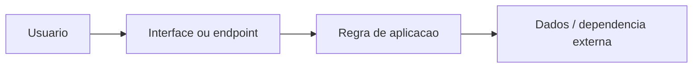

# Arquitetura inicial — AnimeDex

**Stack:** Deno, Supabase, PostgreSQL; Node/Prisma legado. **Referências:** supabase/, scraper-worker/, src/.

O desenho é conceitual. Verifique os módulos reais antes de alterá-los. Para evoluir: introduzir limites claros entre entrada, domínio e infraestrutura; manter configuração segura e testes por camada.

**Restrição:** Não considerar fontes de streaming e scraping garantidas; respeitar direitos autorais e termos das fontes.
