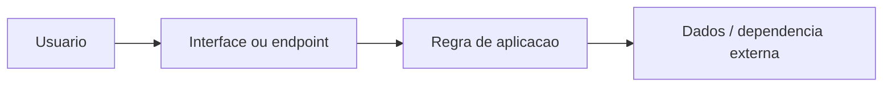

# Arquitetura inicial — AnimeDex

**Stack:** Deno, Supabase, PostgreSQL; Node/Prisma legado. **Referências:** supabase/, scraper-worker/, src/.



O desenho é conceitual. Verifique os módulos reais antes de alterá-los. Para evoluir: introduzir limites claros entre entrada, domínio e infraestrutura; manter configuração segura e testes por camada.

**Restrição:** Não considerar fontes de streaming e scraping garantidas; respeitar direitos autorais e termos das fontes.

## ANX-SEC 1.1.0 — fronteira de confiança da Edge Function ao worker

```text
Stremio → HTTPS → Supabase Edge Function (Deno, segredos do servidor)
                       |
                       | HTTPS + Authorization: Bearer WORKER_API_TOKEN
                       v
                Reverse proxy HTTPS autenticado
                       |
                       | HTTP no loopback 127.0.0.1:8787
                       v
                Worker Express/Cheerio/Puppeteer
                       |
                       | Consulta a origem autorizada
                       v
                Fonte externa configurada
```

O worker valida token antes de rotas de scraping e cache; somente `/health` é pública dentro da rede acessível. O código da Edge recusa HTTP remoto e **não faz fallback para um IP público fixo**. Dados de cache do Supabase usam service role exclusivamente do servidor, nunca do manifesto.

O novo pipeline valida Deno/TypeScript, auth fail-closed, sintaxe Node e bind Docker em loopback. **Não testa tráfego HTTPS real** nem resolve os riscos remanescentes do sandbox Puppeteer, terceiros ou uso de conteúdos sem licença.
